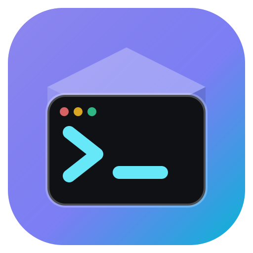

<p align="center">
  
</p>

# devbox

> **Work in progress.** The project is not ready for use. Everything can
> change without notice.

A browser-based dev environment with a dashboard in front of everything.
One image, two ways to run it:

- **Standalone** – one container runs every service at once.
- **Compose** – a lightweight **gatekeeper** container holds the published
  ports, shows a generic loading page and starts the real devbox container
  on the first request. After `IDLE_TIMEOUT` without traffic the devbox
  container sleeps again.

Services:

- **Caddy** – dashboard + reverse proxy (port 8080)
- **code-server** – VS Code in the browser (`/vscode/`)
- **OpenCode** – agent server + web UI (dashboard link)
- **PI WEB** – web UI for the pi coding agent (`/pi/`)
- **ttyd** – web terminal (`/terminal/`)
- **OpenSSH** – shell access (port 8022)
- **ngrok** – CLI for ad-hoc public tunnels (`ngrok http 8080`)

If any service exits, `multirun` stops the whole container. Standalone, use
`--restart unless-stopped` if you want Docker to bring it back. In compose,
the gatekeeper wakes the container on the next request.

## Quick start (compose)

```sh
docker compose up -d --no-start   # build and create both containers
docker compose start gatekeeper   # only the gatekeeper runs
```

What happens next:

1. Open `http://localhost:8080` or any app URL (`/vscode/`, `/terminal/`,
   ...) or SSH port 8022. A web request with valid credentials wakes the
   devbox container; unauthenticated ones get a `401` and wake nothing (see
   [Security](#security)).
2. While a service starts, its URL shows a generic loading page that polls
   and reloads on its own. When the service answers, the real app appears.
   An already running service is served immediately, without the loading
   page. SSH connections are held open until sshd is up.
3. After `IDLE_TIMEOUT` (default 30 minutes) without traffic and without
   open sessions (websockets, terminals, SSH), the devbox container stops
   and an idle gatekeeper is all that is left.

`docker compose up -d` also works: it starts everything at once, and the
devbox container sleeps after the idle timeout.

Watch the stack with `docker compose logs -f gatekeeper devbox-app`.

## Ports

Standalone (one container, everything inside):

| Port | Service | Bind | In `EXPOSE` | Reached via |
|-----:|---------|------|:-----------:|-------------|
| 8080 | Caddy (dashboard & reverse proxy) | all interfaces | yes | `http://<host>:<published>` – the main entry point |
| 8022 | OpenSSH | all interfaces | yes | `ssh -p <published> ubuntu@<host>` |
| 8081 | OpenCode server | `127.0.0.1` | no | via Caddy (dashboard link / catch-all) |
| 8082 | code-server | `127.0.0.1` | no | via Caddy `/vscode/` |
| 8504 | PI WEB | `127.0.0.1` | no\* | via Caddy `/pi/` |
| 8083 | ttyd web terminal | `127.0.0.1` | no | via Caddy `/terminal/` |
| 2019 | Caddy admin API | `localhost` | no | internal |

\* 8504 is loopback-bound by default (`PI_WEB_HOST`), so publishing it with
`-p` does nothing until you set `PI_WEB_HOST=0.0.0.0` (and it would then
bypass the Caddy basic auth).

Routes on port 8080: `/` dashboard, `/vscode/`, `/opencode` (redirect),
`/pi/`, `/terminal/` – everything else is proxied to OpenCode.

Compose: the same ports are published on the **gatekeeper** container. The
devbox container shares the gatekeeper's network stack and listens on
internal ports, reachable only through the gatekeeper:

| Published (gatekeeper) | Internal (devbox) | Service |
|-----------------------:|------------------:|---------|
| 8080 | 18080 | Caddy (dashboard & reverse proxy) |
| 8022 | 18022 | OpenSSH |
| – | 18081 | OpenCode server (loopback only) |
| – | 18082 | code-server (loopback only) |
| – | 18083 | ttyd web terminal (loopback only) |
| – | 18504 | PI WEB (loopback only) |

`EXPOSE` is documentation only; nothing is published without `-p` (or the
compose `ports:` above).

## Environment variables

All are optional and read at **runtime** (`docker run -e NAME=value ...`);
none are baked into the image.

### Dashboard & routing

| Variable | Default | Effect |
|----------|---------|--------|
| `SSH_HOST` | `localhost` | Host name shown in the dashboard's SSH command. |
| `SSH_PUBLISHED_PORT` | `8022` | Port shown in the dashboard's SSH command. Cosmetic only – you still need `-p` to publish container port 8022. |
| `PI_WEB_PATH` | `/pi` | URL prefix PI WEB is served under (leading `/` required). Also drives the gatekeeper's readiness probe for that prefix. |
| `OPENCODE_DIR` | `/home/ubuntu` | Working directory preselected in the dashboard's OpenCode link (encoded as the first URL path segment). |

### Services

| Variable | Default | Effect |
|----------|---------|--------|
| `HTTP_PORT` | `8080` | Caddy listener (dashboard & reverse proxy). |
| `SSH_PORT` | `8022` | OpenSSH listener. |
| `CODE_SERVER_PORT` | `8082` | code-server listener (loopback only). |
| `OPENCODE_SERVER_PORT` | `8081` | OpenCode server listener (loopback only). |
| `TTYD_PORT` | `8083` | ttyd listener (ttyd itself always binds loopback). |
| `PI_WEB_PORT` | `8504` | PI WEB port; overrides `pi/config.json`. |
| `PI_WEB_HOST` | `127.0.0.1` | PI WEB bind address; overrides `pi/config.json`. Set `0.0.0.0` to expose it without Caddy. |
| `PI_WEB_CONFIG` | `/data/pi-web/config.json` | PI WEB config file. Copied from the image default on first start and not overwritten later – prefer env vars for changes. |
| `PI_WEB_DATA_DIR` | `/data/pi-web` | PI WEB data directory (sessions, state). |
| `SSH_AUTHORIZED_KEYS` | – | Extra public keys appended for the `ubuntu` user, on top of `/data/ssh/authorized_keys`. |
| `OPENCODE_SERVER_PASSWORD` | – | Enables HTTP basic auth on the OpenCode server (username `opencode`). Without it the server logs a `server is unsecured` warning. |
| `OPENCODE_SERVER_USERNAME` | `opencode` | Basic-auth username used when `OPENCODE_SERVER_PASSWORD` is set. |
| `BASIC_AUTH_PASSWORD` | – | Enables HTTP basic auth on **all** Caddy routes (dashboard, `/vscode/`, `/terminal/`, `/pi/`, OpenCode). Hashed with bcrypt at start. Without it (and without `BASIC_AUTH_HASH`) the web UI is open and Caddy logs a warning. |
| `BASIC_AUTH_HASH` | – | Ready-made bcrypt hash (`caddy hash-password`) used instead of `BASIC_AUTH_PASSWORD`; keeps the plaintext out of the environment. |
| `BASIC_AUTH_USER` | `devbox` | Username for the Caddy basic auth. |

`caddy/Caddyfile` renders its site port and all upstreams from `HTTP_PORT`,
`CODE_SERVER_PORT`, `OPENCODE_SERVER_PORT`, `TTYD_PORT` and `PI_WEB_PORT` at
container start, so there is no manual coupling to maintain. With a
gatekeeper in front, the internal ports must not collide with its listeners
(`8080`, `8022`); the compose defaults do not.

Fixed (no environment variable): the gatekeeper listen ports – HTTP on
`8080` and raw TCP on `8022`. Change what the host
publishes via the compose `ports:` mapping.

PI WEB understands many more `PI_WEB_*` variables (`PI_WEB_ALLOWED_HOSTS`,
`PI_WEB_MAX_UPLOAD_BYTES`, ...); see the pi-web package for the full list.

### Gatekeeper (compose mode)

| Variable | Default | Effect |
|----------|---------|--------|
| `APP_CONTAINER` | `devbox-app` | Container the gatekeeper starts and stops – the `container_name` of the `devbox-app` service. |
| `IDLE_TIMEOUT` | `30m` | Stop the devbox container after this much time without traffic and without open sessions. `0` disables the idle stop. |
| `START_TIMEOUT` | `2m` | Give up on connections held during startup after this wait. |
| `GATEKEEPER_DOCKER_SOCKET` | `/var/run/docker.sock` | Docker control socket. |
| `BASIC_AUTH_USER` / `BASIC_AUTH_PASSWORD` / `BASIC_AUTH_HASH` | – | Same variables as for Caddy (see above). When a password or hash is set, the gatekeeper answers `401` to unauthenticated web requests **before** waking the devbox container. Pass the same values to both containers. |

The gatekeeper derives its upstreams from the same port variables the
devbox services use. `docker-compose.yml` sets both sides from one anchor
(`x-devbox-env`), so they stay in sync; the gatekeeper's built-in defaults
match that anchor.

The gatekeeper container runs as root because it needs the mounted
`/var/run/docker.sock`. The daemon only calls inspect, start and stop on
`APP_CONTAINER`.

### CLI tokens

Read natively by the tools – just pass them through:

| Variable | Tool | Effect |
|----------|------|--------|
| `GITHUB_TOKEN` (or `GH_TOKEN`) | `gh` | Authenticates the GitHub CLI. |
| `GITLAB_TOKEN` | `glab` | Authenticates the GitLab CLI. |
| `OPENCODE_API_KEY` | OpenCode | API key for the OpenCode Zen and OpenCode Go providers – makes `opencode-go/...` models work without `/connect`. |

```sh
docker run -d -e GITHUB_TOKEN=ghp_... -e GITLAB_TOKEN=glpat-... \
  -e OPENCODE_API_KEY=sk-opencode-... devbox:latest
```

The interactive alternative to `OPENCODE_API_KEY` is `/connect` in the TUI,
which stores the key in `~/.local/share/opencode/auth.json` (stored
credentials win over the env var). Mount that path if you want a `/connect`
login to survive container recreation.

### Ad-hoc ngrok tunnels

The ngrok CLI is installed, but nothing starts automatically – start a
tunnel whenever you need one:

```sh
docker exec -it <container> ngrok http 8080   # Caddy: dashboard, /vscode/, /opencode, /pi/, /terminal/
```

`NGROK_AUTHTOKEN` is picked up natively by the CLI if you pass it to the
container (`-e NGROK_AUTHTOKEN=...`); otherwise run
`ngrok config add-authtoken <token>` once inside it. While a tunnel runs,
ngrok's inspector is on `127.0.0.1:4040` inside the container.

### Advanced paths

| Variable | Default | Effect |
|----------|---------|--------|
| `PI_PREFIX` | `/opt/devbox/pi` | Location of the pi toolchain and its bundled Node. |
| `ASDF_DATA_DIR` | `/data/asdf` | asdf plugins/versions/shims. Mount `/data` to keep installed toolchains. |
| `ASDF_DIR` | `/opt/asdf` | asdf installation (baked into the image – rarely changed). |
| `ASDF_CONFIG_FILE` | `/etc/asdf/config` | asdf config file. |

## Security

devbox gives a shell (and passwordless `sudo`) to whoever reaches it. Do not
expose it to the internet without protection.

- **Web UI:** set `BASIC_AUTH_PASSWORD` (or `BASIC_AUTH_HASH`) so Caddy asks
  for credentials on every route. Basic auth is only safe over HTTPS, so put
  TLS in front (reverse proxy, tunnel, ...). If you also set
  `OPENCODE_SERVER_PASSWORD`, use the same credentials as `BASIC_AUTH_*`:
  the browser sends one `Authorization` header and Caddy forwards it to
  OpenCode.
- **Compose default:** `docker-compose.yml` sets `dev` / `dev` (override
  with `BASIC_AUTH_USER` / `BASIC_AUTH_PASSWORD` in the shell or an `.env`
  file). That is fine locally; change it before exposing the stack.
- **Ports:** only `8080` (Caddy) and `8022` (SSH) are published. code-server
  and OpenCode listen on loopback and are reachable only through Caddy, so
  the auth cannot be bypassed on a side port.
- **SSH:** key-only (`PasswordAuthentication no` in
  `ssh/sshd_config.d/10-devbox.conf`). Supply public keys via
  `SSH_AUTHORIZED_KEYS` or `/data/ssh/authorized_keys`; without one, nobody
  can log in.
- **Gatekeeper:** with `BASIC_AUTH_*` set it checks the credentials itself
  and answers `401` before waking the container, so anonymous web traffic
  can neither start it nor keep it awake. Without credentials, any traffic
  wakes it.
- **SSH and waking:** a raw TCP connection cannot be authenticated by the
  gatekeeper, so with auth enabled SSH never wakes the container. If it is
  asleep the connection is closed; open the web UI and log in first. SSH
  connections only count as activity after 30 s (`LoginGraceTime 20` in
  `ssh/sshd_config.d/10-devbox.conf`), so unauthenticated connection spam
  cannot hold the container awake either.

## Persistent paths

Mount `/data` to survive container recreation. In compose the named volume
`devbox-data` is mounted at `/data` for you:

| Path | Contents |
|------|----------|
| `/data/code-server` | VS Code user data & extensions |
| `/data/asdf` | installed toolchains |
| `/data/pi-web` | PI WEB sessions & config |
| `/data/ssh/authorized_keys` | extra SSH public keys for `ubuntu` |

## Keep in sync

- `caddy/Caddyfile` renders its site port and all upstreams from
  `HTTP_PORT`, `CODE_SERVER_PORT`, `OPENCODE_SERVER_PORT`, `TTYD_PORT` and
  `PI_WEB_PORT` at start (done by `entrypoints/caddy`).
- The gatekeeper's front-door probe paths (`/vscode`, `/terminal`,
  `/opencode`, `PI_WEB_PATH`, `/`) mirror the routes in `caddy/Caddyfile`.
- `docker-compose.yml` sets the internal ports in the `x-devbox-env`
  anchor; the gatekeeper's built-in defaults match that anchor.
- The gatekeeper and Caddy read the same `BASIC_AUTH_*` variables;
  `docker-compose.yml` passes them to both via the `x-auth-env` anchor.
  The gatekeeper's 30 s SSH settle time must stay above `LoginGraceTime`.
- `entrypoints/caddy` writes `auth.caddy` from `BASIC_AUTH_*`; the
  `import auth.caddy` line in `caddy/Caddyfile` must stay the first thing in
  the site block.
- `SSH_PUBLISHED_PORT` ↔ the `-p` mapping used for container port 8022 (or
  the compose `ports:` entry).
